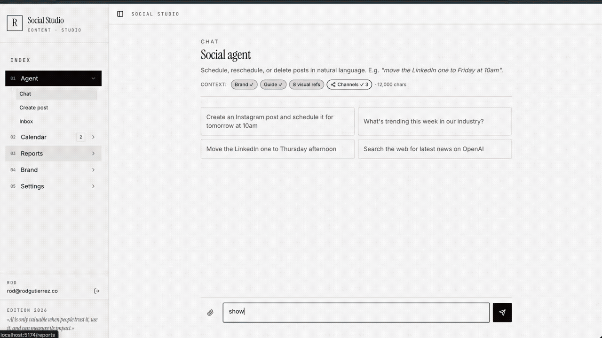
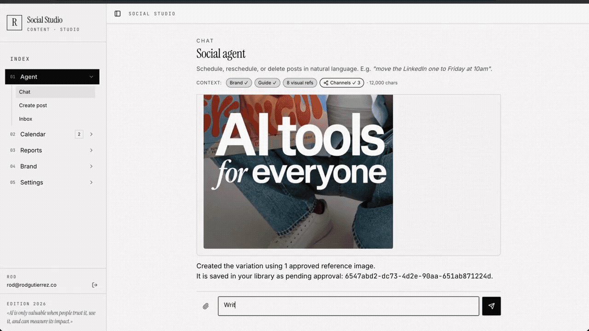
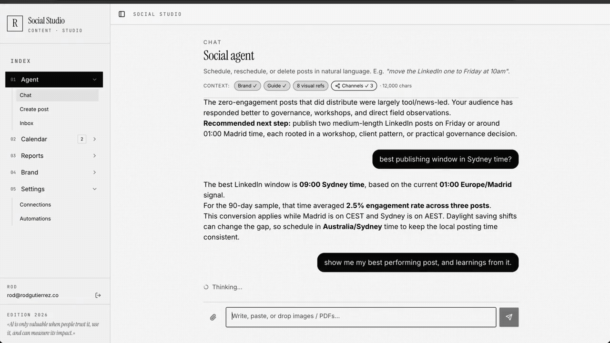
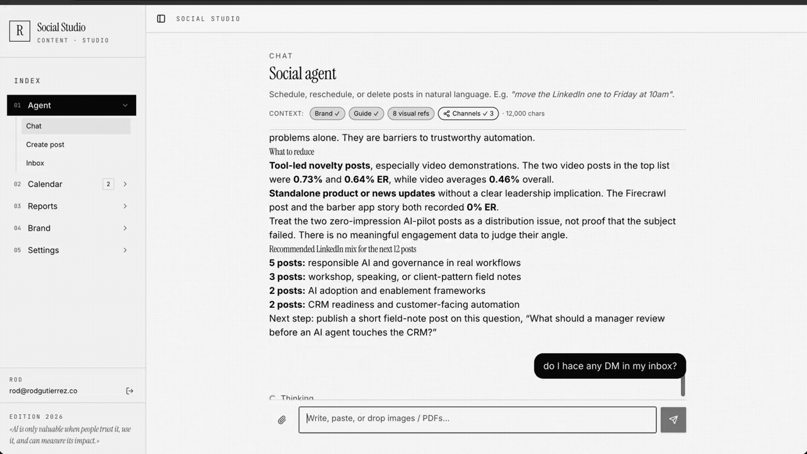

# Pippzo

# The AI that learns and improves by itself — fully autonomous.

> Not a scheduling tool. Not a chatbot. An agent that writes, publishes, replies, and gets smarter every week — while you focus on your actual work.

---

### ✦ Create images from your approved brand guidelines



---

### ✦ Publish directly to your social media and manage your calendar



---

### ✦ Review performance and save learnings



---

### ✦ Manage DMs and comments automatically



---

An AI agent that runs your social media for you — not a scheduling tool, an actual autonomous operator. It writes in your brand voice, generates on-brand images and video, publishes through Buffer, watches your engagement inbox, monitors competitors, and runs fully automated daily jobs. You stay in control through an approval queue.

**Bring your own keys.** No platform accounts, no vendor lock-in, no subscription. You connect your own model provider, image and video generators, and service accounts. Keys are stored encrypted in your own local database.

---

## What it can do

- **Writes in your exact brand voice** — learns how you talk, what words you use, what to never say. Gets better every time you correct it.
- **Generates on-brand images and short videos** — styled after your approved visual library. Supports OpenAI, Gemini, Azure, Runway, Kling, Seedance, and Veo.
- **Publishes to LinkedIn, Instagram, X, Facebook, TikTok** — through Buffer. Queue slot, exact time, or post now. LinkedIn carousels included.
- **Reads your comments and DMs** — classifies by urgency and intent, drafts replies in your voice. Never sends without you approving.
- **Monitors competitors** — scrapes their websites and social profiles, builds full analyst reports. Positioning gaps, content patterns, what you can exploit.
- **Tracks what's working** — pulls real engagement data from Buffer and learns which formats, lengths, and posting times actually perform.
- **Holds an approval queue** — nothing an automation produces ever goes live without you seeing it first.

## What you can automate

Set these up once and they run in the background:

- **Daily post** — agent writes a post, generates a matching image, drops it in your approval queue (or auto-publishes if you turn approval mode off)
- **Competitor scans** — refreshes competitor social data on a schedule
- **Weekly performance reports** — written in plain English by the agent, not a dashboard you have to interpret
- **Engagement inbox drafting** — drafts replies to comments and DMs so you never stare at a blank reply field again
- **Performance reflection** — agent reviews what it predicted vs what actually happened, writes conclusions, gets smarter over time

---

## Prerequisites

Before you start, make sure you have:

- **Node.js ≥ 20.12** — check with `node --version`
- **npm** — the repo ships `package-lock.json`; don't use bun
- **Docker Desktop** — running in the background (Supabase needs it)
- **Supabase CLI** — install with `brew install supabase/tap/supabase` (Mac) or see the [Supabase CLI docs](https://supabase.com/docs/guides/local-development/cli/getting-started)
- **ngrok** — required later for Buffer image publishing — install with `brew install ngrok/ngrok/ngrok` (Mac)

---

## Setup — step by step

### 1. Clone the repo

```bash
git clone https://github.com/Cyrax321/pippzo.git
cd pippzo
```

### 2. Install dependencies

```bash
npm install
```

### 3. Start the local database

```bash
npm run db:start
```

This starts a local Supabase instance (Postgres, Auth, Storage) inside Docker. The first run takes a minute to pull images.

### 4. Copy the environment file

```bash
cp .env.example .env
```

### 5. Fill in `.env`

Run this to see the keys you need:

```bash
supabase status
```

Copy the values it prints into your `.env`:

| `.env` variable                 | Where it comes from                |
| ------------------------------- | ---------------------------------- |
| `SUPABASE_URL`                  | `API URL` from `supabase status`   |
| `SUPABASE_PUBLISHABLE_KEY`      | `Publishable` key                  |
| `SUPABASE_SERVICE_ROLE_KEY`     | `Secret` key                       |
| `VITE_SUPABASE_URL`             | Same as `SUPABASE_URL`             |
| `VITE_SUPABASE_PUBLISHABLE_KEY` | Same as `SUPABASE_PUBLISHABLE_KEY` |

Then generate two random secrets — run this command twice and paste each output:

```bash
openssl rand -hex 32
```

- First output → `PROVIDER_KEY_SECRET` (encrypts your saved API keys — required, never change it after setup)
- Second output → `CRON_TICK_SECRET`

Leave `PUBLIC_APP_URL` empty for now — you'll fill it in the tunnel step below.

`APP_PORT` defaults to `5173` and doesn't need to be set. **If something else on your machine
already listens on 5173**, set `APP_PORT` to a free port instead (e.g. `APP_PORT=5174`) — the dev
server, `npm run tunnel`, and the cron scripts all read this one variable, so nothing else needs
to change. The one exception is Supabase's own auth redirect allow-list, which can't read `.env`:
open `supabase/config.toml`, replace every `5173` under `[auth]` with your port, then run
`npm run db:stop && npm run db:start` to reload it. Skipping that step makes signup confirmation,
Google sign-in and password-reset links bounce to a port with nothing on it.

### 6. Start the dev server

```bash
npm run dev
```

Open **http://localhost:5173** in your browser (or your `APP_PORT`, if you set one).

### 7. Create your account

Go to `/auth` and sign up with any email. Email confirmation is disabled locally — you'll be signed in immediately and a workspace is created for you automatically.

### 8. Add a model API key (required)

Go to **Settings → Connections** and add at least one text model key (Anthropic, OpenAI, or Google). The agent cannot answer until a model is connected.

### 9. Seed a demo brand (optional)

```bash
npm run seed:brand
```

This loads a sample brand profile so the agent has a voice to write in from day one. Then edit `/marca` and `/guia` in the app to replace it with your own brand.

---

## Setting up the tunnel (required for Buffer image publishing)

Buffer downloads your images and videos from a public URL when publishing. Without a tunnel, Buffer can only reach `127.0.0.1` — which it can't — so media attachments on posts will fail.

### Step 1 — Create a free ngrok account

Go to [dashboard.ngrok.com/signup](https://dashboard.ngrok.com/signup) and sign up. It's free.

### Step 2 — Add your authtoken

After signing up, go to [dashboard.ngrok.com/get-started/your-authtoken](https://dashboard.ngrok.com/get-started/your-authtoken) and copy your token. Then run:

```bash
ngrok config add-authtoken YOUR_TOKEN_HERE
```

You only need to do this once per machine.

### Step 3 — Start the tunnel

Open a **separate terminal window** (keep it open while you use the app) and run:

```bash
npm run tunnel
```

This points ngrok at whatever `APP_PORT` is set to (5173 by default), so it always matches the dev
server — no need to pass a port yourself. ngrok will print something like:

```
Forwarding    https://abc123.ngrok-free.app -> http://localhost:5173
```

Copy that `https://` URL.

### Step 4 — Update `.env`

Open `.env` and set:

```
PUBLIC_APP_URL="https://abc123.ngrok-free.app"
```

### Step 5 — Restart the dev server

Stop the server (`Ctrl+C`) and start it again:

```bash
npm run dev
```

> **Note:** The free ngrok plan gives you a new URL every session. Repeat steps 3–5 each time you restart ngrok. A paid ngrok plan gives you a fixed URL so you only set `PUBLIC_APP_URL` once.

---

## Connecting your accounts

Go to **Settings → Connections** to add these. Everything is optional — the app degrades gracefully without them.

| What you want                    | What to connect                      | Where to get it                                                                           |
| -------------------------------- | ------------------------------------ | ----------------------------------------------------------------------------------------- |
| Publish posts                    | Buffer access token                  | [publish.buffer.com/settings/api](https://publish.buffer.com/settings/api)                |
| Generate images                  | OpenAI, Gemini, or Azure key         | Your provider dashboard                                                                   |
| Generate video                   | Veo, Seedance, Kling, or Runway key  | Your provider dashboard                                                                   |
| Engagement inbox                 | Unipile account + LinkedIn connected | [unipile.com](https://unipile.com)                                                        |
| Web search & competitor scraping | Firecrawl and/or ScrapeCreators key  | [firecrawl.dev](https://firecrawl.dev) · [scrapecreators.com](https://scrapecreators.com) |
| Slack notifications              | Slack incoming webhook URL           | Your Slack workspace settings                                                             |

---

## Automations (background jobs)

Automations run on a once-a-minute tick. Start it manually anytime with:

```bash
npm run cron:once
```

Or install a persistent scheduler so automations run automatically:

**macOS:**

```bash
npm run cron:install    # installs a launchd agent
npm run cron:uninstall  # removes it
```

**Linux** — add this to your crontab (`crontab -e`):

```
* * * * * cd /path/to/pippzo && ./scripts/cron-tick.sh
```

> Automations only advance while the app is running and your machine is awake — this is the honest limitation of running locally.

---

## Production build

```bash
npm run build
node .output/server/index.mjs
```

Nothing auto-loads `.env` for the production server — export your variables into the shell or use your host's secret manager before starting. Set `NITRO_PRESET=cloudflare-module` to deploy to Cloudflare Workers.

---

## Learn more

- [DOCUMENTATION.md](DOCUMENTATION.md) — architecture, every subsystem, honest limitations
- [docs/overview.md](docs/overview.md) — non-technical tour of what the agent can do

## License

[MIT](LICENSE)
